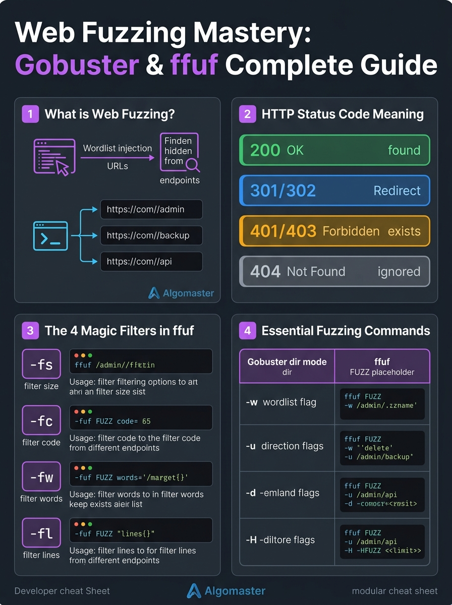
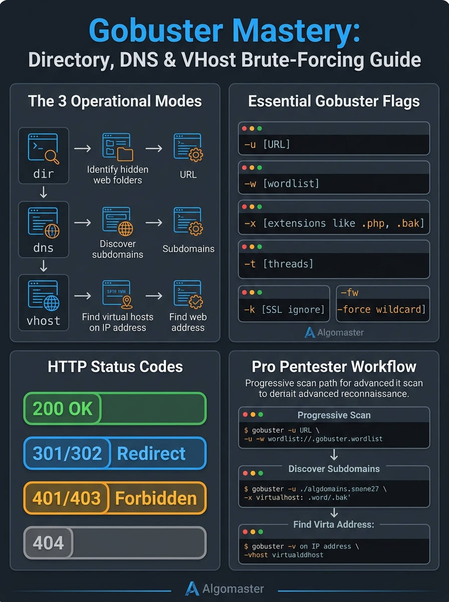

# 📂 Step 3: Web Directory & Parameter Fuzzing (`gobuster` & `ffuf`)

> **Phase 4: Practical Ethical Hacking**  
> *"Websites only show you the links they want you to see. Fuzzing uncovers the secrets they tried to hide."*



---

## 1. The Core Concept: Finding Hidden Doors

When you open a website like `https://example.com/`, the navigation bar only shows links the developer chose to display:
* `Home`
* `About Us`
* `Contact`

However, inside the server's hard drive, there are almost always hidden, unlinked folders and files:
* `/admin/` (Administrative dashboard)
* `/backup.zip` or `/db.sql` (Accidental developer backups)
* `/.git/` (Exposed source code repository)
* `/api/v1/users` (Hidden REST API endpoints)
* `/phpmyadmin/` (Database management login)
* `/test.php` or `/info.php` (Forgotten developer debug files)

Because there are no clickable links to these pages on the homepage, search engines and normal users will never see them. 

**Content Discovery (Fuzzing)** is the technique of testing thousands of common file and folder names at blazing speed to see what the server responds with.

---

## 2. How Web Fuzzing Works (HTTP Status Codes)

A fuzzer takes a **wordlist** containing thousands of common words (`admin`, `login`, `uploads`, `config`, `secret`, `api`) and appends each word to the website's URL:

```text
Wordlist:
┌──────────┐
│ admin    │ ───> GET http://target.com/admin      ───> HTTP 302 (Found! Redirects)
│ uploads  │ ───> GET http://target.com/uploads    ───> HTTP 200 (Accessible!)
│ backup   │ ───> GET http://target.com/backup     ───> HTTP 403 (Forbidden - Exists!)
│ secret   │ ───> GET http://target.com/secret     ───> HTTP 404 (Doesn't exist - Ignore)
│ .env     │ ───> GET http://target.com/.env       ───> HTTP 200 (Jackpot!)
└──────────┘
```

### The Status Codes Pentesters Watch For:
| Status Code | Meaning in Fuzzing | Action |
| :--- | :--- | :--- |
| **`200 OK`** | The file or folder exists and is directly readable! | Investigate immediately. |
| **`301 / 302`** | Redirects to another page (e.g. `/admin` redirects to `/admin/login`). | Endpoint definitely exists. |
| **`401 / 403`** | Unauthorized / Forbidden. | The folder exists, but needs credentials or permission. |
| **`404 Not Found`** | Does not exist. | Ignored by the fuzzer. |
| **`500 Error`** | Server crashed processing that path. | Potential bug or injection point. |

---

## 3. The Two Kings of Fuzzing: Gobuster vs. ffuf

Both tools are written in **Go (Golang)**, making them capable of firing hundreds of requests per second.

### Tool 1: Gobuster (Clean & Simple Directory Brute-Forcing)
Best for fast, reliable directory and DNS scanning:



```bash
# Basic directory scan:
gobuster dir -u http://10.10.10.5/ -w /path/to/wordlist.txt

# Searching for specific file extensions (.php, .txt, .bak):
gobuster dir -u http://10.10.10.5/ -w /path/to/wordlist.txt -x php,txt,bak,html
```

**Key Gobuster Flags:**
* `-u`: Target URL.
* `-w`: Path to the wordlist.
* `-x`: Comma-separated file extensions to append to every word.
* `-t`: Number of concurrent threads (default is 10; use 30–50 for faster scans).
* `-s`: Filter which status codes to display (e.g. `-s "200,204,301,302,307,403"`).

---

### Tool 2: ffuf (Fuzz Faster U Fool — The Ultimate Fuzzing Tool)
`ffuf` is the industry standard for advanced fuzzing. It places the keyword **`FUZZ`** wherever you want to inject your wordlist:

```bash
# Directory Fuzzing:
ffuf -u http://10.10.10.5/FUZZ -w /path/to/wordlist.txt

# Parameter Fuzzing (finding hidden GET parameters):
ffuf -u http://10.10.10.5/page.php?FUZZ=1 -w /path/to/wordlist.txt

# Subdomain Fuzzing (testing Host headers):
ffuf -u http://10.10.10.5/ -H "Host: FUZZ.target.com" -w /path/to/wordlist.txt
```

**Key ffuf Flags:**
* `-u`: Target URL with the `FUZZ` placeholder.
* `-w`: Wordlist file.
* `-fc`: Filter out specific HTTP status codes (e.g., `-fc 404` hides all Not Found errors).
* `-mc`: Match only specific status codes (e.g., `-mc 200,301`).
* `-fs`: Filter out responses by **Size** (essential when a site returns a custom 200 page for every non-existent URL).

---

## 4. The Golden Standard: SecLists

A fuzzer is only as good as the wordlist you feed it.

The cybersecurity industry relies on **[SecLists](https://github.com/danielmiessler/SecLists)** by Daniel Miessler—a curated collection of usernames, passwords, URLs, sensitive files, and fuzzing payloads.

### Most Famous Discovery Wordlists:
1. **`common.txt`** (~4,700 words): Fast, everyday top directories.
2. **`directory-list-2.3-medium.txt`** (~220,000 words): The gold standard for thorough web penetration tests.
3. **`raft-large-files.txt`**: Extensive list for discovering hidden files and backups.

---

## 5. Defensive Countermeasures (How Sysadmins Stop Fuzzing)

1. **Rate Limiting (Fail2ban / WAF):** Dropping connections if an IP sends more than 50 requests in 5 seconds.
2. **Proper Permissions:** Disabling directory browsing (`Options -Indexes`).
3. **Removing Dead Files:** Never leaving `.bak`, `.old`, `.sql`, or `.zip` files in public web directories.
