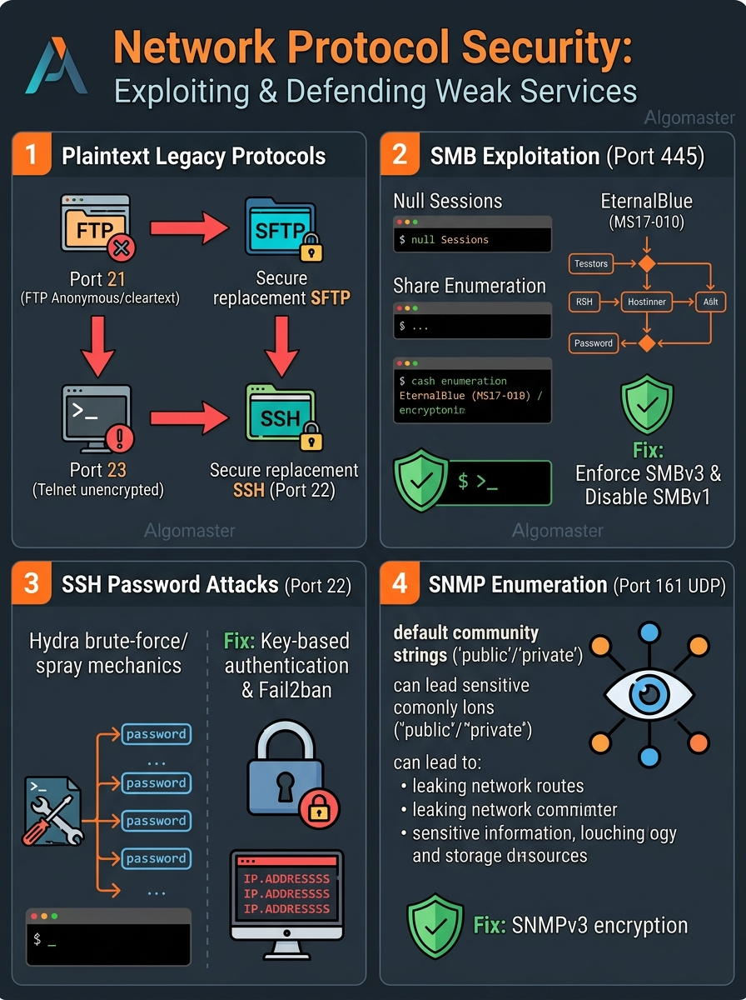

# 🌐 Step 5: Network Security — Exploiting & Securing Weak Protocols

> **Phase 4: Practical Ethical Hacking**  
> *"When Nmap reveals open ports on a server, each protocol represents a distinct doorway with its own legacy design flaws and misconfigurations."*



---

## 1. The Core Attack Surface: Beyond Web Applications

When an attacker or penetration tester discovers open ports beyond Port 80 and 443, they immediately look for **legacy network protocols** that were designed decades ago before encryption was standard.

Here are the **Big 5 Network Protocols** targeted in every infrastructure audit:

---

## 2. Deep Dive: The Big 5 Weak Protocols

### 1. FTP (Port 21 — File Transfer Protocol)
* **The Vulnerability:**
  * **Cleartext Transmission:** Passwords, usernames, and uploaded files travel unencrypted over the wire. Anyone running Wireshark on the local network can capture credentials.
  * **Anonymous Login Misconfiguration:** Administrators often forget to disable guest access. An attacker connects with:
    * Username: `anonymous`
    * Password: `anonymous` (or blank)
* **How Pentesters Test It:**
  ```bash
  # Check for anonymous login:
  ftp 10.10.10.5
  # Name: anonymous
  # Password: [Enter]
  ```
* **Famous Historic Exploit:** **`vsftpd 2.3.4` Backdoor (2011)** — If an attacker sent a username ending with a smiley face `:)`, the server opened a root shell on port 6200!
* **Defensive Fix:** Migrate to **SFTP (SSH File Transfer Protocol)** running securely over port 22.

---

### 2. Telnet (Port 23 — Remote Terminal)
* **The Vulnerability:**
  * Telnet is the ancestor of SSH. It provides a text-based terminal over the network, but **with zero encryption**.
  * Every single keystroke—including your administrator password—is sent as plain text across the network.
* **Why it matters:** If Telnet is exposed on the internet or across an internal LAN, packet sniffers (like ARP spoofers or Wireshark) can capture root credentials in real time.
* **Defensive Fix:** **Completely disable Telnet.** Replace it with **SSH (Port 22)**.

---

### 3. SSH (Port 22 — Secure Shell)
* **The Vulnerability:**
  * SSH itself uses strong modern cryptography (AES, ChaCha20, Ed25519) and cannot be decrypted easily.
  * **The weakness is human:** Weak passwords, reused credentials, and allowing direct `root` login over the internet.
* **How Pentesters Test It (Hydra Password Spraying):**
  Using **Hydra** to test our curated wordlists:
  ```bash
  hydra -L wordlists/usernames.txt -P wordlists/passwords.txt ssh://10.10.10.5 -t 4
  ```
* **Defensive Fix:**
  1. Disable password authentication entirely: `PasswordAuthentication no` in `/etc/ssh/sshd_config`.
  2. Enforce **SSH Key Pairs** (Ed25519).
  3. Install **Fail2ban** to automatically ban IPs after 3 failed login attempts.
  4. Disable direct root login: `PermitRootLogin no`.

---

### 4. SMB (Port 445 — Server Message Block)
* **The Vulnerability:**
  * Designed for Windows local network file sharing.
  * Running over the public internet exposes systems to **Null Sessions**, unauthorized share discovery, and kernel bugs.
* **How Pentesters Test It:**
  ```bash
  # Enumerate public shares with no password:
  smbclient -L //10.10.10.5 -N

  # Connect to a discovered share:
  smbclient //10.10.10.5/Public -N
  ```
* **Famous Historic Exploit:** **MS17-010 (EternalBlue)**:
  * A buffer overflow vulnerability inside the Windows SMBv1 kernel driver (`srv.sys`).
  * Allowed unauthenticated attackers to execute arbitrary code with `SYSTEM` (root) privileges (used in the global WannaCry ransomware outbreak).
* **Defensive Fix:**
  1. Block Port 445 at the edge firewall completely.
  2. Disable the legacy **SMBv1** protocol across all servers.
  3. Enforce SMB signing and SMBv3 encryption.

---

### 5. SNMP (Port 161 UDP — Simple Network Management Protocol)
* **The Vulnerability:**
  * Used by network engineers to monitor routers, switches, and servers.
  * SNMP versions 1 and 2c use plain-text passwords called **Community Strings**.
  * Administrators almost always leave them set to the factory defaults:
    * **`public`** (Read-Only)
    * **`private`** (Read-Write)
* **How Pentesters Test It:**
  ```bash
  # Dump all device info using the default 'public' community string:
  snmpwalk -v2c -c public 10.10.10.5
  ```
* **What Leaks:**
  * Full list of running system processes and services.
  * Internal IP routing tables and MAC addresses.
  * Server hostnames, usernames, and network interface configurations.
* **Defensive Fix:**
  1. Upgrade to **SNMPv3**, which introduces cryptographic authentication (SHA) and encryption (AES).
  2. Change default community strings away from `public` and `private`.

---

## 3. High-Speed Protocol Testing Cheat Sheet

| Protocol | Port | Primary Pentest Check | Default / Weak Vector |
| :---: | :---: | :--- | :--- |
| **FTP** | `21` | `ftp <IP>` | `anonymous:anonymous` |
| **Telnet** | `23` | Packet sniffing / Cleartext capture | Zero encryption |
| **SSH** | `22` | `hydra -l user -P pass.txt ssh://<IP>` | Weak passwords / Root login |
| **SMB** | `445` | `smbclient -L //<IP> -N` | Null sessions / SMBv1 exploits |
| **SNMP** | `161` | `snmpwalk -v2c -c public <IP>` | Default string `public` |
