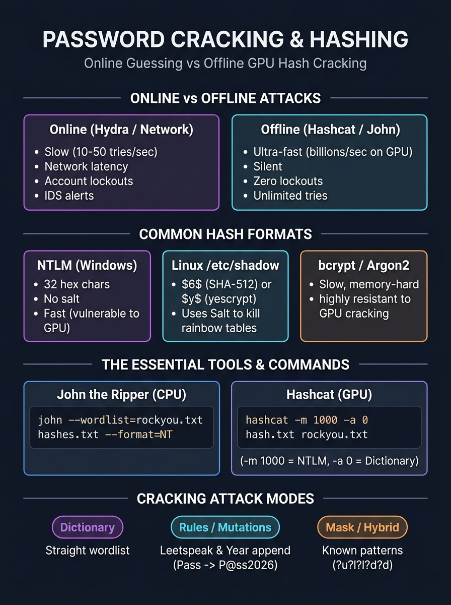

# 🔴 Step 07 — Password Attacks & Offline Cracking Mechanics

> **Objective:** Understand how passwords fail across networks and operating systems. Learn the mathematics of cryptographic hashing, how salts defeat precomputed rainbow tables, and master offline GPU/CPU cracking using **Hashcat** and **John the Ripper**.

---

## 🖼️ Password Cracking & Hashing Visual Card



---

## 1. Online vs. Offline Attacks

Password attacks fall into two fundamentally different operational paradigms:

| Metric | Online Attacks (Hydra, Medusa, Burp) | Offline Attacks (Hashcat, John the Ripper) |
| :--- | :--- | :--- |
| **Target** | Live network port (SSH, FTP, Web Login, RDP). | Dumped database table, Windows SAM/NTDS, Linux `/etc/shadow`. |
| **Speed** | **Slow:** $10\text{ to }50$ attempts/second (limited by network latency). | **Ultra-Fast:** $10^8\text{ to }10^{11}$ hashes/second on modern GPUs. |
| **Noise & Alerts** | **Extremely High:** Triggers SIEM alerts, IDS/IPS, and web application firewalls. | **Zero:** Completely invisible to the victim's network. |
| **Account Lockouts** | High risk of locking domain accounts or getting IP banned (Fail2ban). | **Impossible:** The target server does not even know their hashes are being cracked. |
| **Best Used For** | Gaining initial foothold via default/weak credentials. | Cracking harvested hashes after gaining internal access. |

---

## 2. Cryptographic Hashing & The Math Behind "Cracking"

A cryptographic hash is a **one-way mathematical function** ($H(x) = y$):
* **Deterministic:** The exact same input string always yields the identical hash.
* **Irreversible:** You cannot mathematically calculate $x$ from $y$.
* **Avalanche Effect:** Altering a single character (`Pass1` $\rightarrow$ `pass1`) completely randomizes the entire hash output.

```
+--------------------------------------------------------------------------+
|                        HOW HASH CRACKING WORKS                           |
+--------------------------------------------------------------------------+
|  Candidate Word: "dragon"  ──[ Hash Algorithm (e.g., MD5) ]──> 7ac66c... |
|                                                                    │     |
|                                                                    ▼     |
|  Target Stolen Hash:                                           7ac66c... |
|                                                                    │     |
|  Does Computed Hash MATCH Stolen Hash? ───────────────────> [ MATCH! ]  |
|                                                     Cracked: "dragon"    |
+--------------------------------------------------------------------------+
```

> [!NOTE]
> We never "decrypt" a hash. We **generate candidate hashes** from wordlists at blazing speeds until one matches the stolen hash string.

---

## 3. The Power of Salts & Rainbow Tables

* **Rainbow Table:** A massive, precomputed database of passwords and their corresponding hashes. If an attacker has an un-salted hash like `5f4dcc3b5aa765d61d8327deb882cf99`, they can look it up in a table in 0.001 seconds to reveal `password`.
* **Salt:** A cryptographically random string (e.g., `k9$m!X2`) generated automatically by the operating system and prepended to the password before hashing:
  $$\text{Hash} = \text{Algorithm}(\text{Salt} + \text{Password})$$

```
WITHOUT SALT (Fatal Flaw):
User 1 ("password") ──> 5f4dcc3b5aa765d61d8327deb882cf99  (Identical hash!)
User 2 ("password") ──> 5f4dcc3b5aa765d61d8327deb882cf99  (Identical hash!)

WITH UNIQUE SALT:
User 1 ("password" + "9bF2") ──> 3a89e17b8f... (Completely unique)
User 2 ("password" + "kL89") ──> f901b22e1a... (Completely unique)
```
> [!IMPORTANT]
> **Salts completely destroy rainbow tables.** Because the salt is unique for every user, an attacker cannot use precomputed tables; they must compute a unique cracking loop for every single account individually.

---

## 4. Identifying Common Operating System Hash Formats

### A. Windows NTLM (New Technology LAN Manager)
* **Storage Location:** Windows Registry (`SAM` hive) or Active Directory Domain Controller (`ntds.dit`).
* **Format:** 32 hexadecimal characters (MD4 hash of UTF-16 little-endian password).
* **Major Flaw:** **NTLM has NO salt!**
* **Example:** `aad3b435b51404eeaad3b435b51404ee:31d6cfe0d16ae931b73c59d7e0c089c0` (The first half is legacy LM; the second half is NTLM for empty password).

### B. Linux `/etc/shadow`
Linux passwords store the algorithm, salt, and hash separated by dollar signs (`$`):
```text
root:$6$n8G4Jk2Q$xO1f9K8P...u71:19750:0:99999:7:::
      │     │              │
      │     │              └─ Hashed password
      │     └─ Cryptographic Salt (e.g., n8G4Jk2Q)
      └─ Algorithm ID ($6$ = SHA-512 crypt)
```

| Identifier | Algorithm | Modern Security Status |
| :--- | :--- | :--- |
| **`$1$`** | MD5 crypt | Obsolete & broken. Cracks in seconds. |
| **`$5$`** | SHA-256 crypt | Moderate. |
| **`$6$`** | SHA-512 crypt | Common default in Linux distributions. |
| **`$y$`** | yescrypt | Modern memory-hard default (Debian 12 / Ubuntu 22+). |

### C. Web Application Hashes (Fast vs. Slow)
* **Fast Hashes (VULNERABLE):** MD5, SHA-1, SHA-256. Intended for file integrity; modern GPUs test **billions** per second.
* **Slow / Memory-Hard Hashes (SECURE):** **bcrypt** (`$2b$`), **Argon2** (`$argon2id$`), **PBKDF2**. Specifically designed to run slow on GPUs and demand massive memory per iteration.

---

## 5. Cracking Tools: John the Ripper vs. Hashcat

### Tool 1: John the Ripper (JtR)
Best for CPU-based cracking, automated format detection, and parsing esoteric formats.

```bash
# 1. Cracking Linux shadow hashes (combine /etc/passwd and /etc/shadow first)
unshadow /etc/passwd /etc/shadow > unshadowed.txt

# 2. Run John with a wordlist
john --wordlist=rockyou.txt unshadowed.txt

# 3. View successfully cracked passwords
john --show unshadowed.txt
```

#### Extracting Hashes from Encrypted Files:
John provides conversion utilities that convert files into crackable hash strings:
```bash
zip2john secret.zip > zip.hash         # Extract hash from password-protected ZIP
ssh2john id_rsa > ssh.hash             # Extract hash from passphrase-protected SSH key
keepass2john database.kdbx > keepass.hash
```

---

### Tool 2: Hashcat (The GPU King)
Hashcat is the world's fastest cracking utility, using OpenCL/CUDA to harness the parallel cores of graphics cards.

#### Hashcat Command Syntax:
```bash
hashcat -m <HASH_MODE> -a <ATTACK_MODE> <HASH_FILE> <WORDLIST>
```

| Common `-m` (Hash Type) Codes | Description |
| :--- | :--- |
| **`-m 0`** | Plain MD5 |
| **`-m 1000`** | Windows NTLM |
| **`-m 1800`** | Linux SHA-512 crypt (`$6$`) |
| **`-m 3200`** | bcrypt (`$2a$`, `$2b$`) |
| **`-m 13100`** | Kerberos 5 TGS-REP (Kerberoasting) |

#### Common `-a` (Attack Modes):
1. **`-a 0` (Straight / Dictionary):** Tests each word in `rockyou.txt` line by line.
   ```bash
   hashcat -m 1000 -a 0 ntlm_hashes.txt /usr/share/wordlists/rockyou.txt
   ```
2. **`-a 0` with Rules (Mutations):** Takes words like `password` and applies real-world transformation rules (`Password123!`, `p@ssw0rd`):
   ```bash
   hashcat -m 1000 -a 0 ntlm_hashes.txt rockyou.txt -r /usr/share/hashcat/rules/best64.rule
   ```
3. **`-a 3` (Mask / Brute-Force):** Uses known structure patterns:
   ```bash
   # Cracks an 8-character password starting with Uppercase, 5 lowercase, and 2 digits (?u?l?l?l?l?l?d?d)
   hashcat -m 1000 -a 3 ntlm_hashes.txt ?u?l?l?l?l?l?d?d
   ```

---

## 6. Defensive Countermeasures

1. **Length over Complexity:** An 18-character passphrase (`correct-horse-battery-staple`) has exponentially higher entropy ($>90\text{ bits}$) than an 8-character complex string (`P@ssw0rd`), making brute force computationally impossible.
2. **Upgrade to Argon2id / bcrypt:** Ensure web backends never store user passwords using simple SHA-256 or MD5. Use Argon2id with calibrated memory and time cost factors.
3. **Implement Robust Multi-Factor Authentication (MFA):** Even if an offline database dump is cracked, the attacker cannot authenticate without the user's hardware token or authenticator app.
