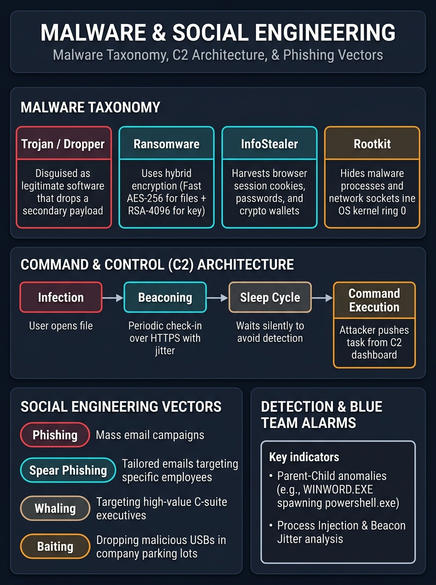

# 🔴 Step 08 — Malware Concepts & Social Engineering

> **Objective:** Demystify how adversaries establish access through human deception and software payloads. Understand modern malware taxonomy, hybrid ransomware encryption, Command & Control (C2) beaconing, and reverse-proxy MFA bypass.

---

## 🖼️ Malware Architecture & Social Engineering Visual Card



---

## 1. Modern Malware Taxonomy

Malware is not a single tool; it is a classification of malicious software based on payload objectives:

```
+-------------------------------------------------------------------------------+
|                              MALWARE CLASSIFICATION                           |
+-------------------------------------------------------------------------------+
|  1. Dropper / Loader  --> Small initial stager that evades AV & pulls payload.
|  2. InfoStealer       --> Steals browser session cookies, passwords, crypto.
|  3. Ransomware        --> Hybrid encryption locking enterprise disks.
|  4. Rootkit           --> Kernel ring 0 driver hiding processes & sockets.
|  5. Botnet / Worm     --> Self-propagating node for DDoS or proxy networks.
+-------------------------------------------------------------------------------+
```

### Detailed Breakdown of Core Categories:

#### A. Trojans, Loaders, and Droppers
* **Dropper (Stage 1):** A lightweight binary disguised as a harmless utility (e.g., `Setup.exe` or an invoice PDF). Its sole purpose is to establish persistence, bypass Windows Defender, and securely download the heavier **Stage 2** payload into memory.
* **Reflective DLL Injection:** Modern loaders inject shellcode directly into RAM of legitimate processes (`explorer.exe`, `svchost.exe`), ensuring the malware never touches the physical hard drive.

#### B. Ransomware: The Mathematics of Hybrid Encryption
Why doesn't ransomware use just one encryption algorithm?
* **Problem with Asymmetric (RSA/ECC) alone:** RSA is mathematically complex and way too slow to encrypt 500 GB of files before IT notices.
* **Problem with Symmetric (AES) alone:** AES uses the same key to lock and unlock. If the AES key is stored on the victim's computer, security analysts can extract it from memory and decrypt everything for free!

**The Hybrid Solution:**
$$\text{File Data} \xrightarrow{\text{Fast AES-256}} \text{Encrypted File}$$
$$\text{AES Key} \xrightarrow{\text{Attacker's Public RSA Key}} \text{Encrypted AES Key}$$

1. The ransomware generates a temporary **AES-256 key** on the fly and rapidly encrypts the victim's files.
2. It then encrypts that AES key using the **attacker's hardcoded RSA Public Key**.
3. It deletes the raw AES key from memory.
4. **Result:** Only the attacker holds the matching **RSA Private Key** needed to unlock the AES key. Without paying the ransom or finding an implementation flaw, decryption is mathematically impossible.

#### C. InfoStealers (RedLine, Vidar, Lumma, Racoon)
The modern cybercrime economy revolves around InfoStealers rather than raw destruction:
* They scrape Chromium and Firefox SQLite databases:
  * Saved browser logins & auto-fill data.
  * **Session Cookies** (allowing attackers to hijack active Gmail, AWS, or Slack sessions without needing a password or 2FA!).
  * Cryptocurrency browser extensions (MetaMask, Phantom).

#### D. Rootkits (User Mode vs. Kernel Mode)
* **Ring 3 (User Mode):** Hooks Windows API calls (`NtQuerySystemInformation`) to filter out the malware's name when Task Manager queries running processes.
* **Ring 0 (Kernel Mode):** Modifies internal operating system structures (e.g., SSDT — System Service Descriptor Table or Direct Kernel Object Manipulation). Even enterprise antivirus cannot detect a driver running with higher OS privileges than itself.

---

## 2. Command and Control (C2) Architecture

Once a payload executes, how does the attacker control it without setting off corporate firewalls?

Modern Red Teams and adversaries use **C2 Frameworks** (e.g., *Cobalt Strike*, *Sliver*, *Mythic*, *Havoc*).

```
[ Compromised Host ] ──( HTTPS Beacon with Jitter )──> [ C2 Redirector ] ──> [ C2 Team Server ]
         │                                                                             │
         └─────────────<==== [ Encrypted Tasks: "whoami", "hashdump" ] <===============┘
```

### The Beaconing Lifecycle:
1. **Initial Check-in:** The compromised agent (called a **Beacon** or **Implant**) opens an outbound TLS connection over port 443 to the C2 server.
2. **Sleep & Jitter (The Anti-Detection Secret):**
   * If a computer pings an unknown external IP address every exact 60.00 seconds, automated SIEMs flag it as a bot immediately.
   * **Jitter** introduces randomness: $\text{Sleep} = 60\text{ seconds} \pm 30\%$. The beacon checks in at $42\text{s}$, then $78\text{s}$, then $55\text{s}$, mimicking normal human browsing patterns.
3. **Malleable C2 Profiles:**
   * The attacker transforms beacon traffic so network packet inspectors see normal traffic:
   * Example: Disguising C2 commands as standard Google Analytics cookies (`__utm=...`) or Microsoft telemetry HTTP headers.

---

## 3. Social Engineering: The Human Vector

Technological defenses can be impenetrable, but **humans remain the most vulnerable attack surface**.

```
+-------------------------------------------------------------------------------+
|                        SOCIAL ENGINEERING TAXONOMY                            |
+-------------------------------------------------------------------------------+
|  1. Phishing        --> Mass-blast deceptive emails (fake bank/invoice notices).
|  2. Spear Phishing  --> Deeply researched, targeted attacks against an individual.
|  3. Whaling         --> High-stakes targeting of C-Level executives (CEO/CFO).
|  4. Vishing         --> Voice phishing / AI deepfake phone calls.
|  5. Smishing        --> SMS lure pretending to be postal delivery or bank alert.
|  6. Baiting         --> Leaving weaponized USBs in corporate parking lots.
+-------------------------------------------------------------------------------+
```

### Advanced Phishing: Bypassing Multi-Factor Authentication (MFA)
How do modern attackers defeat 2FA / TOTP codes?

* **Legacy Phishing (Dead):** Clone a login page $\rightarrow$ steal username and password $\rightarrow$ fail because 2FA blocks the attacker.
* **Modern Adversary-in-the-Middle (AiTM) Phishing (Active):**
  * Attackers use reverse-proxy tools like **Evilginx2**.
  * The fake phishing link proxies live traffic directly to the real login server (e.g., Microsoft 365 or Google).
  * The user enters their password AND their real 2FA code.
  * The real server validates the login and issues an **Authenticated Session Cookie**.
  * **Evilginx2 intercepts the session cookie.**
  * The attacker imports that cookie into their browser and is **instantly logged in as the victim**, completely bypassing MFA!

---

## 4. Blue Team Detection: What Sets Off Alarms?

To be an elite ethical hacker or penetration tester, you must know what causes **EDR (Endpoint Detection and Response)** to trigger:

| Suspicious Behavior | What EDR Sees | Why It Triggers Alarms |
| :--- | :--- | :--- |
| **Parent-Child Process Anomaly** | `WINWORD.EXE` spawns `powershell.exe` or `cmd.exe`. | Word documents have no business executing command shells. High confidence malicious macro. |
| **Living off the Land (LotL)** | `certutil.exe -urlcache -f http://...` | Using native Windows binaries (LOLBins) to download executables. |
| **Process Injection** | A non-admin process writes memory into `svchost.exe`. | Memory scanning flags reflective DLL or thread hijacking. |
| **Beacon Network Patterns** | Outbound HTTPS requests to an unclassified domain with rhythmic timing. | Network behavior analysis detects C2 communication. |

---

## 5. Defensive Countermeasures

1. **FIDO2 / Hardware Security Keys (YubiKey):** Hardware keys bind cryptographic authentication to the exact domain origin in the browser URL. They are mathematically immune to Evilginx2 reverse-proxy phishing!
2. **Attack Surface Reduction (ASR) Rules:** Disable Office macros and block Word/Excel from spawning child processes.
3. **Process Lineage Monitoring:** Configure Sysmon / EDR to monitor Event ID 1 (Process Creation) and hunt for suspicious command-line flags.
