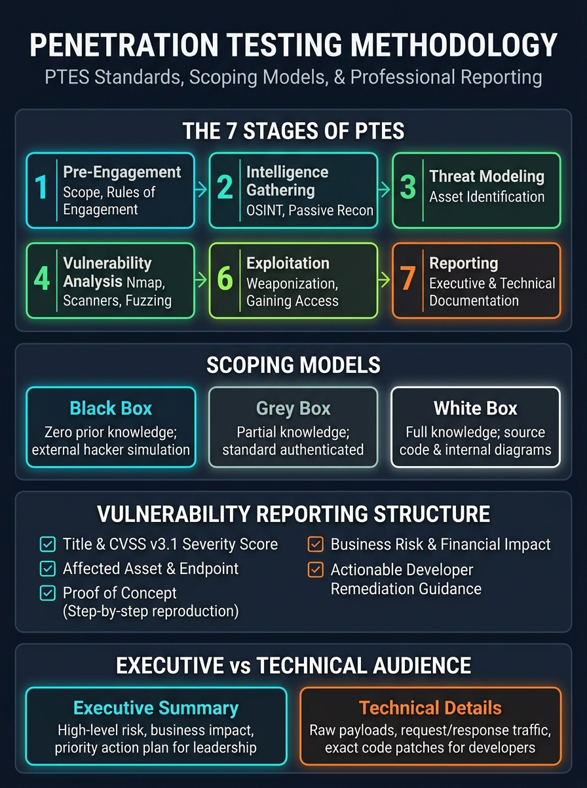

# 🔴 Step 09 — Penetration Testing Methodology & Reporting

> **Objective:** Bridge raw technical exploitation into professional security consulting. Master the 7 stages of the Penetration Testing Execution Standard (PTES), scoping models, legal rules of engagement, and authoring world-class vulnerability reports for both executives and developers.

---

## 🖼️ Penetration Testing Methodology & Reporting Visual Card



---

## 1. Ethical Hacking vs. Illegal Intrusion: The Legal Boundary

The technical tools used by cybercriminals and ethical penetration testers are identical. **The only difference is legal authorization.**

```
+---------------------------------------------------------------------------------+
|                       THE 3 LEGAL PILLARS OF A PENTEST                          |
+---------------------------------------------------------------------------------+
|  1. Non-Disclosure Agreement (NDA)   --> Protects client proprietary data.      |
|  2. Statement of Work (SOW)          --> Defines exact scope, schedule, and cost.|
|  3. Letter of Authorization (LoA)    --> The "Get Out of Jail Free" card.       |
|                                         Signed by C-level executive granting    |
|                                         explicit permission to attack assets.   |
+---------------------------------------------------------------------------------+
```

> [!CAUTION]
> **Never touch a target without a signed Letter of Authorization.** Probing an IP address or web endpoint without written consent violates international cyber laws (CFAA in the US, Computer Misuse Act in the UK) regardless of your intentions.

---

## 2. Assessment Scope Models

During pre-engagement scoping, the client and pentesting firm agree on one of three assessment models:

| Model | Attacker Knowledge | Client Deliverable to Tester | Real-World Simulation |
| :--- | :--- | :--- | :--- |
| **Black Box** | **Zero.** Only company name and public domain. | List of domains / IP ranges. | Simulates an external, opportunistic adversary or nation-state hacker. |
| **Grey Box** *(Most Common)* | **Partial.** Standard user account credentials. | Low-privilege login (`user:pass`), API documentation. | Simulates an insider threat (disgruntled employee) or an external hacker who stole basic credentials. |
| **White Box** | **Full.** Complete internal transparency. | Source code repositories, network architecture diagrams, admin accounts. | Comprehensive code audit and architecture review; highest vulnerability coverage. |

---

## 3. The 7 Phases of the PTES Standard

The **Penetration Testing Execution Standard (PTES)** is the globally recognized framework governing how commercial assessments are conducted:

```
[ 1. Pre-Engagement ] ──> [ 2. Intelligence Gathering ] ──> [ 3. Threat Modeling ]
                                                                     │
[ 6. Post-Exploitation ] <── [ 5. Exploitation ] <── [ 4. Vulnerability Analysis ]
         │
         └──> [ 7. Reporting & Debrief ]
```

1. **Pre-Engagement Interactions:** Defining the Rules of Engagement (RoE), IP ranges, out-of-scope production databases, emergency contact phone numbers, and testing hours.
2. **Intelligence Gathering:** Passive and active reconnaissance (OSINT, DNS records, Shodan, certificate logs, tech stack fingerprinting).
3. **Threat Modeling:** Identifying the client’s high-value business assets (e.g., customer PII, credit card databases, intellectual property, Active Directory).
4. **Vulnerability Analysis:** Discovering security weaknesses using tools and manual testing (Nmap service scans, ffuf directory fuzzing, code reviews).
5. **Exploitation:** Safely weaponizing vulnerabilities (e.g., executing SQL injection, dropping a Meterpreter reverse shell) to prove exploitability.
6. **Post-Exploitation:** Determining the business impact of the compromise (privilege escalation, dumping password hashes, pivoting between network subnets).
7. **Reporting:** Translating technical findings into actionable business risk and remediation blueprints.

---

## 4. Executive Summary vs. Technical Report

A professional report is divided into two distinct sections tailored for two completely different audiences:

```
+--------------------------------------------------------------------------+
|                            THE PENTEST REPORT                            |
+--------------------------------------------------------------------------+
|                                                                          |
|  PART 1: EXECUTIVE SUMMARY  (For CEO, CFO, Board of Directors, Legal)   |
|  - High-level business risk overview.                                    |
|  - Overall Security Maturity Rating (e.g., High Risk / Failing).         |
|  - Financial, regulatory (GDPR, PCI-DSS), and reputational consequences. |
|  - Prioritized strategic remediation roadmap with budget suggestions.    |
|                                                                          |
|  ----------------------------------------------------------------------  |
|                                                                          |
|  PART 2: TECHNICAL FINDINGS (For DevOps, Sysadmins, Software Engineers)  |
|  - Comprehensive vulnerability catalog ordered by CVSS severity.        |
|  - Exact affected URLs, IP addresses, and source code parameters.        |
|  - Step-by-step Proof of Concept (PoC) with screenshots & HTTP traffic.  |
|  - Exact defensive code patches and server configuration fixes.          |
+--------------------------------------------------------------------------+
```

---

## 5. Anatomy of a Professional Vulnerability Finding

Every finding inside your report must follow a strict, standardized anatomy:

```markdown
### [CRITICAL] SEC-01: Unauthenticated Remote Code Execution via SQL Injection

* **Vulnerability Type:** SQL Injection (CWE-89)
* **CVSS v3.1 Score:** 9.8 (Critical) `CVSS:3.1/AV:N/AC:L/PR:N/UI:N/S:U/C:H/I:H/A:H`
* **Affected Asset:** `https://api.victim-corp.com/v1/orders/track`
* **Vulnerable Parameter:** `order_id` (HTTP GET parameter)

#### 1. Technical Description & Root Cause
The order tracking endpoint fails to sanitize user input before concatenating it 
directly into a backend PostgreSQL dynamic SQL query string. 

#### 2. Proof of Concept (Step-by-Step Reproduction)
1. Send the following HTTP request using curl or Burp Suite:
   ```http
   GET /v1/orders/track?order_id=101+UNION+SELECT+null,username,password_hash+FROM+users HTTP/1.1
   Host: api.victim-corp.com
   ```
2. The server returns HTTP 200 OK containing full database password hashes:
   ```json
   {
     "status": "success",
     "tracking_code": "admin",
     "notes": "$6$salt$e10adc3949ba59abbe56e057f20f883e"
   }
   ```

#### 3. Real-World Business Impact
An unauthenticated external attacker can dump the entire enterprise database, 
stealing all 450,000 customer records and administrator credentials, leading to 
severe GDPR compliance fines (up to €20M) and catastrophic brand reputation loss.

#### 4. Remediation Guidance
Replace dynamic string concatenation with parameterized prepared statements:
```python
# SECURE FIX:
cursor.execute("SELECT * FROM orders WHERE order_id = %s", (user_order_id,))
```
```

---

## 6. The 4 Golden Rules of Professional Reporting

1. **Reproducibility is King:** If a developer cannot reproduce the bug following your exact PoC steps in under 5 minutes, your finding will be rejected.
2. **Never Shame Developers:** Frame findings as systemic risks and engineering opportunities, not individual developer incompetence.
3. **No Exploits Without Solutions:** Every single finding must contain a clear, actionable, and copy-pasteable defensive remediation fix.
4. **Clean Up After Yourself:** All dropped backdoors, test user accounts, uploaded webshells, and temporary files created during testing must be deleted before submitting the final report.
